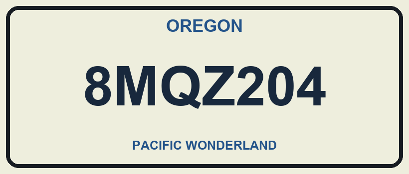

# VisionForge AI · AMD AI League Match 2

**Offline OCR for US and Chinese license plates and road signs on AMD ROCm.** VisionForge AI reads PNG, JPEG and TIFF images and writes one JSON result per image. It runs a pinned Qwen3-VL-2B-Instruct model on the GPU, with the weights packaged in the Docker image so inference can run without network access.

## Example



The direct ROCm run returned the following for this [synthetic fixture](data/competition/us_clean.png).

```json
{"text": "8MQZ204"}
```

For US plates, the prompt extracts the registration and excludes state banners and slogans. For Chinese plates, it preserves the province character. For road signs, it reads words and numbers in line order.

## How it works

1. The container starts one GPU worker that loads and warms the model.
2. The CLI sends the image to the worker through a local Unix socket. The model receives the full frame and, when useful, an additional crop of the text region.
3. The CLI writes the result to `/app/output/<image-stem>_output.json`.

Inside the running container, the competition harness invokes the CLI like this.

```bash
python3 /app/app.py --input-image /app/input/us_clean.png
```

## Reproduce the checks

For the full Docker check, use a Linux x86-64 host with a compatible AMD GPU and ROCm driver, access to `/dev/kfd` and `/dev/dri`, Docker Engine 29.8+, Python 3.11+ with `venv`, and disk space and network access for the build.

```bash
git clone https://github.com/NuraliKuzhagaliev/match-2.git
cd match-2
bash competition/check.sh
```

The script builds the image, runs the synthetic cases in one container, and records timings, GPU memory and contract checks in `evidence/competition/amd-acceptance.json`. In a ROCm notebook with provider-installed PyTorch, run `python3 -m competition.notebook_setup` for direct GPU validation. See the [technical runbook](competition/README.md) for both paths.

## Measured results

| Check | Result |
| --- | --- |
| Direct ROCm OCR on AMD Radeon Pro W7900D | 10/10 main and 7/7 additional synthetic cases matched |
| Startup and warm-up · direct ROCm | 16.01 s |
| Ten CLI calls after startup · direct ROCm | 3.57 s total |
| Observed peak GPU memory · direct ROCm | 4.790 GiB |
| Local Docker image | Required base layers, packaged code and weights, offline processor and size checks passed |
| Published image | Anonymous manifest lookup and pull passed with existing local layers |
| GPU inference inside the published image and a cold pull | Pending |

The synthetic cases cover the input and output contract and selected OCR conditions. Accuracy on the organizer's hidden dataset remains unknown. The published image reference is kept in the private competition submission materials.

Evidence: [direct ROCm run](evidence/competition/gpu-release-20261101/evidence/competition/notebook-acceptance-release.json) · [Docker image verification](evidence/competition/image-verification.json) · [fixture manifest](data/competition/manifest.json).

## Source guide

| Path | Contents |
| --- | --- |
| [`competition/`](competition/) | Dockerfile, model configuration, GPU worker, CLI and validation runner |
| [`data/competition/`](data/competition/) | Synthetic images and expected text |
| [`tests/competition/`](tests/competition/) | Automated contract and runtime checks |
| [`evidence/competition/`](evidence/competition/) | Run reports and build evidence |

The [Qwen3-VL-2B-Instruct model](https://huggingface.co/Qwen/Qwen3-VL-2B-Instruct) is Apache-2.0. The synthetic fixture images are CC0-1.0.

## AMD AI League Match 3

The companion [Match 3 repository](https://github.com/NuraliKuzhagaliev/amd-match3) contains an offline document question-answering system. It retrieves evidence across documents and images and returns short answers with file citations.
